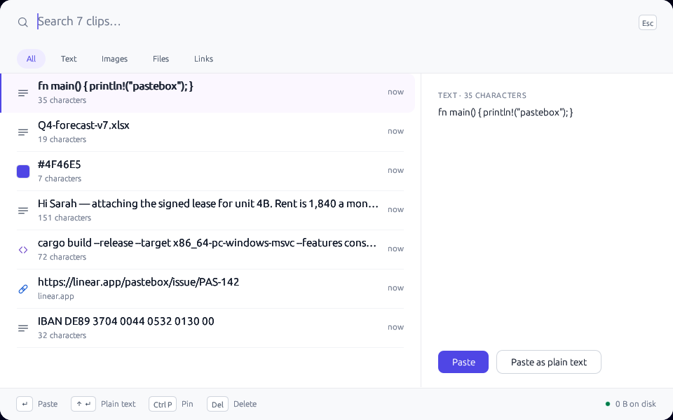

# Pastebox

**A clipboard history that opens instantly, searches properly, and remembers nothing you didn't pin.**

Press `Win+Alt+V`. A quiet panel opens over whatever you're doing with everything you've copied —
text, links, images, files — newest first. Type three letters, hit Enter, and it's pasted where you
were. Nothing leaves your machine, and nothing is written to disk unless you pin it.



## Download

**[Pastebox.exe — latest release](https://github.com/nullpointio/pastebox/releases/latest)**

- Windows 10/11, x64. One portable exe (~3 MB), no installer, no runtime to install.
- The exe is **unsigned**: SmartScreen will warn on first run (`More info → Run anyway`). SHA-256 hashes
  are on the release page.

## Why not Windows' own Win+V?

Windows keeps 25 items, has no search, wipes the list on restart, drops anything over 4 MB, and never
records files at all. Pastebox keeps 500 items, searches them as you type, captures files and images,
and lets you pin the ten things you paste all day.

## Privacy — read this before you install it

A clipboard manager sees everything you copy, including passwords. Pastebox is built around that:

- **No network code in the binary.** No sync, no telemetry, no update check, no crash reporting.
- **Nothing is written to disk unless you pin it.** Unpinned history lives in memory and dies with the
  process. The footer shows how much is on disk, which is `0 B` unless you have pins.
- **Pinned items only** are saved, to a single plain-text file you can read and delete.

If you copy from a password manager, most already suppress clipboard history on their side.

## Use

| Key | Action |
|---|---|
| `Win+Alt+V` | open / hide the panel (falls back to `Win+Shift+V`, then `Ctrl+Alt+V` if taken) |
| type | filter as you type |
| `↑` `↓` | move selection |
| `Enter` | paste into the window you were in |
| `Ctrl+P` | pin / unpin |
| `Del` | remove the row |
| `Esc` | close |

## What it is not

No cloud sync, no accounts, no mobile app, no OCR of images, no rich-text preservation (plain text and
file lists only). It is not a password manager.

## Build

Native Rust, no runtime:

```bash
cargo test -p pastebox-core -p pastebox-ui --release
cargo build --release -p pastebox-app        # on Windows
# cross-compile from Linux (MinGW):
cargo build --release --target x86_64-pc-windows-gnu -p pastebox-app
```

`pastebox-core` is pure logic (model, dedupe, search ranking, pins) with 94 tests and no platform code.
`pastebox-ui` is the egui surface. `pastebox-platform` is the Win32 layer: clipboard listener, global
hotkey, paste-back, tray. `pastebox-app` wires them together and exposes `-smoke` / `-selftest` so CI
runs the actual exe on Windows before any release.

## License

MIT — see [LICENSE](LICENSE).
